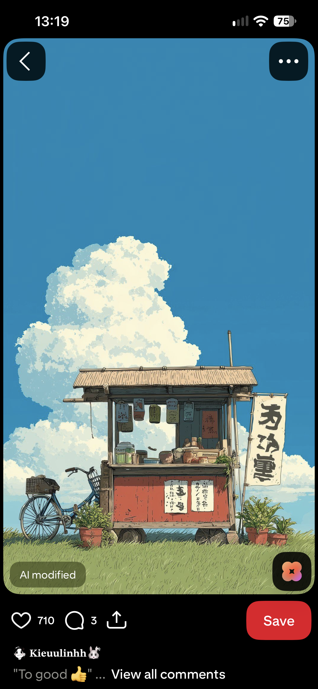

# Moodboard

Visual references for Yutoriba's look and feel. Reference only — these are
other people's images, so don't repost them. Use them to guide our own shots.

## Roadside stall, summer sky

Source: Pinterest screenshot (marked "AI modified").

**What we like**

- One small, human-scale place under a huge, empty sky: room to breathe (*yutori*)
- Flat, saturated palette: deep blue sky, cream clouds, red cart, green grass
- Hand-made details: thatched roof, hanging lanterns, paper signs, potted plants
- A parked bicycle: someone stopped here and is staying a while
- Lots of negative space at the top: good for text overlays in 9:16

**Palette**

| Colour | Use |
| --- | --- |
| Sky blue `#3C7FB8` | Backgrounds, title cards |
| Cloud cream `#F4EFD9` | Text, highlights |
| Cart red `#C2553F` | Accent, CTA |
| Grass green `#7C9A4E` | Secondary accent |
| Wood tan `#C9A97A` | Borders, textures |

**How to shoot it ourselves**

- Low angle, camera near the ground, subject in the bottom third, sky filling the rest
- Clear summer day with big cumulus clouds, mid-afternoon
- Small stalls, kissaten fronts, coffee carts, and bikes parked outside
- Hold the shot still for 3–5 seconds; let the clouds do the moving
